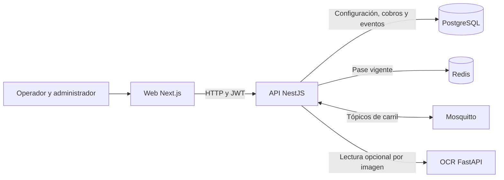

# CarQ

CarQ gestiona un carril de parqueadero. Registra entradas y salidas a partir de la placa, distingue carros y motos y genera cobros según la franja horaria. Un pago habilita el pase del día operativo. El operador usa Carril y Caja. El administrador configura la sede y puede anular cobros pendientes. Ambos roles pueden consultar eventos y cobros.

## Stack y arquitectura

- **Web** con Next.js, React y TypeScript.
- **API** con NestJS, TypeScript, TypeORM, JWT y Swagger.
- **Servicios** con PostgreSQL para persistencia, Redis para pases vigentes y Mosquitto como broker MQTT.
- **OCR opcional** en un servicio Python con FastAPI y FastALPR.
- **Pruebas** con Jest, el ejecutor de Node.js, pytest y Playwright.



## Arranque local del MVP

Instala Node.js 24 y Docker con Compose v2 y deja Docker en ejecución. Clona el repositorio y ejecuta el comando de arranque desde su raíz.

```sh
node scripts/arrancar-local.mjs
```

El comando crea `.env` a partir de `.env.example` si hace falta. Levanta PostgreSQL, Redis y Mosquitto, ejecuta las migraciones y carga los datos de demostración antes de levantar la API y el frontend. La primera construcción descarga las imágenes y dependencias.

- [Frontend e inicio de sesión](http://localhost:3000/login)
- [Swagger de la API](http://localhost:3001/docs)

| Rol           | Usuario de prueba | Contraseña de prueba |
| ------------- | ----------------- | -------------------- |
| Operador      | `operador`        | `operador123`        |
| Administrador | `administrador`   | `administrador123`   |

En el modo simulado puedes iniciar sesión como operador, usar **Carril** para registrar un vehículo y **Caja** para pagarlo. Como administrador puedes revisar **Administración** y **Consulta**.

Para usar el OCR real, configura `LECTOR_PLACAS=http` en `.env`, inicia el servicio con `docker compose --profile ocr up -d --build --wait lpr` y vuelve a ejecutar el comando de arranque. Para detener el MVP conservando el volumen de desarrollo usa `docker compose stop api web db redis mqtt`.

## Variables de entorno

| Variable                     | Uso y valor de ejemplo                                                                                                       |
| ---------------------------- | ---------------------------------------------------------------------------------------------------------------------------- |
| `NODE_ENV`                   | Entorno de Node.js. Por defecto, `development`.                                                                              |
| `PUERTO`                     | Puerto interno de la API. Compose usa `3000` y publica el `3001` en el host.                                                 |
| `ZONA_HORARIA`               | Zona IANA del día operativo, `America/Bogota`.                                                                               |
| `INICIO_DIA_OPERATIVO`       | Inicio del día operativo en formato HH:mm, `06:00`.                                                                          |
| `LECTOR_PLACAS`              | Lector `simulado`, `manual` o `http`.                                                                                        |
| `FUENTE_SENSOR`              | Fuente de presencia `simulado` o `mqtt`.                                                                                     |
| `CONTROLADOR_BARRERA`        | Control de barrera `simulado` o `mqtt`.                                                                                      |
| `URL_BASE_DATOS`             | Conexión de la API a PostgreSQL en `db:5432/carq` dentro de Compose.                                                         |
| `URL_REDIS`                  | Redis para pases en `redis://redis:6379` dentro de Compose.                                                                  |
| `URL_MQTT`                   | Broker en `mqtt://mqtt:1883` dentro de Compose.                                                                              |
| `URL_LPR`                    | Dirección de OCR para el lector HTTP, `http://lpr:8000` dentro de Compose.                                                   |
| `URL_LPR_PRUEBAS`            | Dirección de OCR para pruebas desde el host, `http://127.0.0.1:8000`.                                                        |
| `URL_WEB`                    | Origen permitido por CORS, `http://localhost:3000`.                                                                          |
| `JWT_SECRETO`                | Clave de firma. Define un valor propio en `.env`.                                                                            |
| `JWT_EXPIRACION`             | Duración de sesión, `8h`.                                                                                                    |
| `URL_BASE_DATOS_MIGRACIONES` | Conexión para migraciones lanzadas desde el host, `localhost:5432/carq`. El arranque dentro de Compose usa `URL_BASE_DATOS`. |
| `URL_BASE_DATOS_PRUEBAS`     | PostgreSQL de pruebas en `localhost:5433/carq_pruebas`.                                                                      |
| `URL_REDIS_PRUEBAS`          | Redis de pruebas en `redis://localhost:6380`.                                                                                |
| `URL_MQTT_PRUEBAS`           | Broker Mosquitto aislado para las pruebas de integración, `mqtt://127.0.0.1:1884`.                                           |

## Pruebas

La suite completa requiere Docker en ejecución, Node.js 24 y Python 3.12. Instala una vez las dependencias desde la raíz.

```sh
npm --prefix api ci
npm --prefix web ci
python -m pip install -r lpr/requirements-dev.txt
npm --prefix web exec -- playwright install chromium
```

Ejecuta la suite desde la raíz.

```sh
npm test
```

El comando levanta PostgreSQL, Redis y Mosquitto de pruebas y el servicio OCR. Ejecuta unitarias de API, frontend y LPR, integración con servicios reales y los grupos de navegador de navegación, operador, Administración y Consulta. Devuelve un código distinto de cero si falla una etapa.

Para detener los servicios de pruebas tras una ejecución usa `docker compose stop db_pruebas redis_pruebas mqtt_pruebas lpr`. Si también usas el OCR en el MVP, conserva `lpr` en ejecución.

## Verificar el arranque

Después de ejecutar el comando de arranque, comprueba que responden el frontend, Swagger y el inicio de sesión de los dos roles.

```sh
node scripts/verificar-arranque.mjs
```
